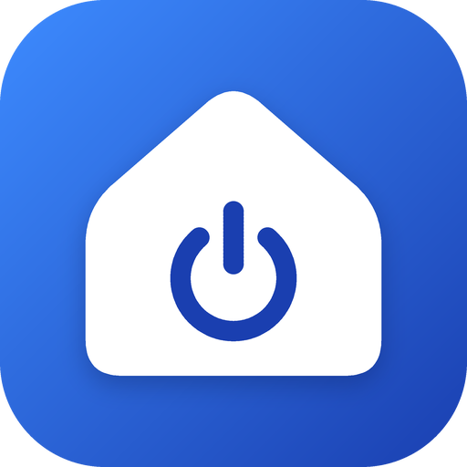

<p align="center">
  
</p>

<h1 align="center">Hommaterial</h1>

<p align="center"><b>Comanda la tua smart home Alexa, senza fronzoli.</b></p>

<p align="center">Android · Web · Windows 11 (anteprima) · Gratuita · Open source</p>

<p align="center">
  <a href="https://github.com/carellice/hommaterial/releases/latest" title="Scarica il file APK dall'ultima release"></a>
  <a href="https://carellice.github.io/hommaterial/"></a>
  <a href="https://github.com/carellice/hommaterial/releases/latest" title="Scarica lo ZIP Windows dall'ultima release"></a>
</p>

<p align="center"><a href="pwa/README.md">Guida di configurazione web</a> · <a href="windows/README.md">Guida Windows</a></p>

**Windows 11:** scarica lo ZIP Windows dalle [release GitHub](https://github.com/carellice/hommaterial/releases),
estrailo interamente in una cartella personale e avvia `Hommaterial.Windows.exe`.
Gli aggiornamenti si scaricano dall'app, in **Impostazioni → Controlla aggiornamenti**.
Per pubblicare Android e Windows da questo PC usa `release.bat`: [guida al rilascio](RELEASING.md).

<p align="center">
  <a href="docs/video/hommaterial-promo.mp4"></a>
</p>

<p align="center">🎬 Il video di presentazione, con l'audio: <a href="docs/video/hommaterial-promo.mp4"><b>orizzontale 16:9</b></a> · <a href="docs/video/hommaterial-promo-verticale.mp4"><b>verticale 9:16</b></a></p>

Un'app Android nativa, veloce e minimale per comandare i dispositivi smart home
collegati al proprio account Alexa.

---

# ⚠️ ATTENZIONE ⚠️

# APP NON UFFICIALE

# NON AFFILIATA AD AMAZON

# USO A PROPRIO RISCHIO

> ## Leggi prima di installare
>
> - **Hommaterial non è un prodotto Amazon.** Non è affiliata, sponsorizzata,
>   approvata né supportata in alcun modo da Amazon.com, Inc. o dalle sue
>   società collegate. "Amazon", "Alexa" ed "Echo" sono marchi di Amazon.com,
>   Inc. o delle sue affiliate, citati qui solo per descrivere con cosa l'app
>   è compatibile.
> - **Usa API non ufficiali e non documentate.** L'app comunica con i server
>   di Amazon presentandosi come l'app Alexa ufficiale. Questo con ogni
>   probabilità **viola le condizioni d'uso di Amazon**.
> - **Il tuo account è a rischio.** Amazon può limitare, sospendere o chiudere
>   gli account che usano client non autorizzati. Può anche cambiare le sue API
>   in qualsiasi momento e l'app può **smettere di funzionare senza preavviso**.
> - **L'app gestisce l'accesso al tuo account Amazon.** Il login avviene sulla
>   pagina di Amazon mostrata dentro l'app; sul telefono resta salvato un token
>   che dà accesso al tuo account Alexa. Installa solo build che hai compilato
>   tu o di cui ti fidi, e **non installare mai versioni modificate da
>   sconosciuti**.
> - **Comanda dispositivi reali.** Prese, stufe, climatizzatori: un errore
>   dell'app o un tocco sbagliato accende o spegne cose vere in casa tua.
> - **Nessuna garanzia.** Il software è fornito "così com'è", senza garanzie
>   di alcun tipo. Gli autori non rispondono di danni, perdite di dati, blocchi
>   dell'account o qualsiasi altra conseguenza derivante dal suo uso.
>
> ## Se non accetti tutto questo, non usare l'app.

---

## Cosa fa

- Mostra i dispositivi raggruppati per stanza, come configurati in Alexa.
- Un tocco accende o spegne.
- Nell'angolo di ogni riquadro un simbolo dice come risponde: se un tocco
  accende e spegne, esegue delle azioni o apre il pannello, e se tenendolo
  premuto si apre il resto. La legenda è in fondo alla lista e nelle
  Impostazioni.
- Dal menu, "Riordina" apre l'elenco dei riquadri di ogni sezione, da mettere
  in ordine con le frecce.
- Nelle Impostazioni, in Aspetto, i dispositivi si mostrano a griglia o a
  elenco.
- La lente in alto cerca i dispositivi mentre si scrive: il primo trovato è
  evidenziato, e Invio lo accende o spegne, esegue un dispositivo
  personalizzato o apre il pannello di un sensore o di un telecomando.
- Tenendo premuto si apre il pannello con accensione, spegnimento esplicito,
  timer, luminosità e colore per le luci che li supportano. Il timer spegne
  oppure accende, a scelta, dopo uno dei tempi già pronti o dopo ore e
  minuti scelti con **Personalizzato…**.
- I timer in corso stanno in una sezione in cima alla lista, con il conto
  alla rovescia, ordinati dal più vicino allo spegnimento.
- I preferiti, anche i gruppi, stanno in cima alla lista.
- Da **Riordina** si sceglie anche la larghezza di ogni riquadro: una o due
  colonne. Su uno schermo stretto si adatta allo spazio disponibile.
- Ogni azione si sente sotto il dito: una vibrazione breve e diversa per
  accensione e spegnimento, per un dispositivo personalizzato eseguito, un
  tasto del telecomando, un timer avviato o un tag NFC scritto, piccoli scatti
  mentre si regola la luminosità, e una vibrazione d'errore quando un comando
  non riesce. Nelle Impostazioni, in Aspetto, si spegne o se ne sceglie
  l'intensità con uno slider, che mentre lo si trascina fa sentire ogni livello.
- Il widget per la schermata Home mostra i dispositivi e i gruppi scelti
  nelle Impostazioni, dove si regolano anche ordine, colonne, dimensione dei
  riquadri, intestazione e sfondo.
- Lo stesso widget si può mettere anche sulla schermata di blocco, dove
  Android lo consente: Android 16 QPR2 e successivi, e i tablet con l'hub
  dei widget.
- Fino a dieci dispositivi a scelta si comandano dalle Impostazioni rapide di
  Android, ognuno con il suo riquadro.
  Sotto il nome del dispositivo il riquadro mostra la stanza in cui si
  trova, o un gruppo che lo contiene se non ha una stanza.
  Anche un sensore o un termostato può stare in un riquadro: lì mostra la
  temperatura attuale, e un tocco la rilegge.
- Dall'intestazione di una stanza si accende o spegne tutto in una volta.
- Col microfono in alto si dice "accendi la lampada" o "spegni tutto in
  salotto". Capisce solo accensione e spegnimento, e chiede conferma quando il
  nome non è esatto o riguarda una stanza intera.
- Mostra temperatura e umidità dei sensori, con il grafico dell'ultimo giorno
  o dell'ultima settimana. I dati li raccoglie il telefono quando l'app o il
  widget si aggiornano, quindi il grafico parte vuoto e può avere dei buchi.
  Il grafico ha la scala dei valori, gli orari o i giorni, minimo, media e
  massimo; tenendo il dito su un punto se ne legge il valore e l'ora.
- Avvisa con una notifica quando un sensore supera o scende sotto una
  temperatura scelta.
- Permette di nascondere i dispositivi che non interessano.
- All'apertura mostra subito l'ultimo stato noto e lo aggiorna in sottofondo.
- Controlla una volta al giorno se su GitHub c'è una versione più recente e,
  se confermi, la scarica e la installa. Il controllo si può anche avviare a
  mano da "Controlla aggiornamenti" nel menu.
- Dal menu si aprono le Impostazioni: tema chiaro, scuro o automatico,
  vibrazione, lingua, notifiche, aggiornamenti, stanze, preferiti e dispositivi nascosti,
  riquadri, timer e avvisi attivi, e il backup su file delle proprie scelte.
  Prima di importare un backup si scelgono le categorie da ripristinare:
  per esempio gruppi e dispositivi personalizzati senza cambiare i preferiti.
  Le categorie escluse conservano i dati locali; i dispositivi Alexa arrivano
  dall’account Amazon, non dal backup.
- Le stanze si possono riorganizzare dentro l'app, creandone quante se ne
  vuole e scegliendo i dispositivi di ognuna, senza cambiare niente in Alexa.
- I gruppi accendono o spengono insieme più dispositivi di stanze diverse.
  Tenendo premuto un gruppo si apre il suo pannello: i dispositivi si
  comandano uno per uno e il timer, che spegne o accende, vale per tutto il
  gruppo.
- Sotto l'icona dell'app, tenendola premuta, compaiono i dispositivi e i
  gruppi scelti nelle Impostazioni, oppure i preferiti.
- **Tag NFC**: dal pannello di un dispositivo, di un gruppo o di un
  dispositivo personalizzato, **Scrivi su un tag NFC** scrive un tag che lo
  accende, lo spegne, lo inverte o lo esegue. Basta avvicinarci il telefono,
  anche con l'app chiusa, purché lo schermo sia acceso: a schermo spento
  Android non legge i tag. Sulla schermata di blocco funziona se nelle
  impostazioni dell'NFC è disattivato «Richiedi lo sblocco del dispositivo
  per l'NFC».
- Sugli schermi larghi, come i tablet, una barra laterale divide la casa in
  pagine (tutto, preferiti, gruppi e una per stanza) e il pannello di un
  dispositivo si apre di lato.
- La modalità monitor, dalle Impostazioni, trasforma un tablet nel pannello
  della casa: si scelgono le pagine, il loro ordine e i dispositivi di
  ognuna, la dimensione dei riquadri e l'orologio; lo schermo resta acceso e
  a tutto schermo e gli stati si aggiornano da soli. Ogni tablet ha il suo
  pannello, anche con lo stesso account.
- In modalità monitor, dopo qualche minuto senza tocchi compare la schermata
  di riposo: schermo abbassato, orologio, data, sensori, dispositivi accesi
  e timer, a scelta. Di notte può restare solo l'orologio, al minimo.
- Un PIN facoltativo protegge la modalità monitor: serve per aprire le
  Impostazioni e per uscire, e chi tocca il pannello può solo comandare i
  dispositivi. Il backup include la modalità monitor, senza il PIN, e
  all'importazione chiede se ripristinarla.

- Collegando l'account SwitchBot dalle Impostazioni compaiono i telecomandi a
  infrarossi creati sull'hub: TV (accensione, volume, canali), condizionatore
  (temperatura, modalità, ventola) e i tasti dei telecomandi fai da te, da
  aggiungere scrivendone il nome com'è nell'app SwitchBot. Passano dall'API
  ufficiale di SwitchBot, con il token e la chiave segreta presi dalla sua
  app, che restano sul telefono.
  I tasti si aggiungono anche più alla volta e sono disegnati come su un
  telecomando, con il simbolo o il colore quando il nome lo dice. Un
  telecomando che non serve si nasconde dalla lista, come gli altri
  dispositivi.
- I TV LG con webOS si comandano direttamente sulla rete di casa, senza
  account né cloud: dalle Impostazioni → TV LG l'app li cerca sulla rete (o
  prende l'indirizzo scritto a mano) e il TV chiede di accettare la richiesta
  sul suo schermo. Il telecomando si apre a tutto schermo, con accensione
  (Wake-on-LAN), volume, canali, frecce e OK, Indietro, Home, muto, i tasti
  del lettore e, come tasti propri, le app e gli ingressi del TV. Funzionano
  solo con il telefono sulla stessa rete del TV; per accenderlo da spento va
  attivata sul TV l'accensione dalla rete.
- Solo su Android, un assistente AI corregge i comandi dati con il microfono in
  alto: conosce i nomi di dispositivi, stanze, dispositivi personalizzati e
  telecomandi, e se dici «accendi televisione Flavio» capisce che intendi
  «TV Flavio». Interviene solo quando la frase non corrisponde già esattamente
  a un nome; dopo la correzione l'app esegue il comando come sempre, quindi
  agisce solo su cose che esistono. Funziona con Cloudflare Workers AI e un
  account gratuito dell'utente: Impostazioni → Assistente AI guida passo per
  passo nella creazione dell'account, dell'Account ID e del token. Al primo
  collegamento chiede a parole cosa sono le cose dai nomi poco chiari; le
  risposte, che aiutano a riconoscere i soprannomi, si correggono in «Cosa sa
  l'assistente».

- I dispositivi personalizzati sono riquadri che con un tocco eseguono una
  serie di azioni, una dopo l'altra: accendere o spegnere dispositivi,
  premere tasti dei telecomandi, aspettare qualche secondo. Possono dipendere
  da un dispositivo, con azioni diverse se è acceso o spento. Si creano dalle
  Impostazioni e si aprono tenendoli premuti.
  Si avviano anche dal widget e dai riquadri delle Impostazioni rapide.
- Telecomandi e dispositivi personalizzati si possono mettere nelle stanze,
  accanto agli altri dispositivi.
- Telecomandi e dispositivi personalizzati hanno le stesse comodità degli
  altri dispositivi: il timer (spegnere un telecomando, premere un suo tasto
  o eseguire un dispositivo personalizzato tra un po'), i preferiti, i
  comandi vocali ("esegui la postazione", "spegni la TV del salotto") e, per
  i dispositivi personalizzati, le scorciatoie sotto l'icona dell'app.
- In cima alla lista, sotto i timer, compaiono le azioni programmate che si
  ripetono, con il tempo che manca alla prossima, e le automazioni attive;
  da lì si sospendono con un tocco.
- Dal menu si creano le automazioni: quando un sensore supera o scende sotto
  una temperatura o un'umidità, oppure quando un dispositivo si accende o si
  spegne, l'app accende o spegne un dispositivo, esegue un dispositivo
  personalizzato o preme un tasto di un telecomando.
- Dal menu si impostano le azioni programmate: accendere o spegnere un
  dispositivo, eseguire un dispositivo personalizzato o premere un tasto di
  un telecomando a una certa ora, una volta sola o nei giorni scelti, oppure
  tra qualche minuto. Una notifica dice com'è andata.

Non fa altro, di proposito: niente routine, niente musica. La voce la
trascrive il riconoscimento vocale del telefono, non l'app.

Anche le azioni programmate le fa scattare il telefono, come i timer: all'ora
stabilita deve essere acceso e connesso, e senza rete riprova per dieci minuti.

Il timer di spegnimento lo fa scattare il telefono: all'ora stabilita deve
essere acceso e connesso. Una notifica dice com'è andata: dispositivo spento,
oppure timer non riuscito. Se non c'è rete riprova per dieci minuti prima di
rinunciare.

Le automazioni seguono gli stessi tempi degli avvisi di temperatura: scattano
quando il telefono legge lo stato, non nell'istante in cui cambia.

Gli avvisi di temperatura li controlla il telefono, circa ogni 15 minuti e
più di rado quando è fermo da un po': non sono un allarme in tempo reale.

## Versione Windows 11

Nella cartella [`windows`](windows/README.md) c'è la prima versione nativa in
**C# e WinUI 3**, con stanze Alexa, preferiti, ricerca, luci, sensori e timer
mentre l'app è aperta. Include una modalità demo per provarla senza account,
build autonoma x64/ARM64 e preparazione del pacchetto MSIX per una futura
distribuzione sul Microsoft Store. Le funzioni avanzate sono ancora in porting:
consulta [funzioni, limiti e istruzioni di prova](windows/README.md).

## Versione web

Nella cartella [`pwa`](pwa) c'è la stessa app come PWA, da aprire nel browser
o da installare sulla schermata Home, anche su iPhone:
**[carellice.github.io/hommaterial](https://carellice.github.io/hommaterial/)**. Ha bisogno di un
piccolo proxy su Cloudflare Workers, che crei tu, e funziona solo mentre è
aperta: niente widget, riquadri rapidi né azioni in sottofondo. Le
istruzioni, con la guida di configurazione passo per passo, sono in
[`pwa/README.md`](pwa/README.md).

## Limiti noti

- L'interfaccia è in italiano e in inglese e segue la lingua del telefono; con
  le altre lingue è in inglese.
- È stata provata solo con un account **amazon.it**. Alla schermata di accesso
  si possono scegliere altri marketplace (amazon.de, .fr, .es, .co.uk, .com),
  ma **non sono stati verificati**.
- Sono gestiti accensione/spegnimento, luminosità, colore delle luci (da un
  elenco fisso di colori e bianchi) e sensori di temperatura. Termostati,
  tapparelle e scene non sono ancora supportati.
- Richiede Android 8.0 o successivo.

## Dati e privacy

- L'app parla con i server di Amazon e, solo per cercare e scaricare gli
  aggiornamenti, con GitHub, a cui non invia alcun dato dell'account. Non ci
  sono server intermedi, statistiche né pubblicità.
- Solo se colleghi SwitchBot, l'app parla anche con i server di SwitchBot, per
  elencare i telecomandi e inviare i loro comandi.
- Solo se configuri l'assistente AI, l'app invia a Cloudflare Workers AI, con
  il tuo account, le frasi dettate al microfono che l'app non capisce da sola,
  i nomi di dispositivi, stanze e tasti e le note che gli hai insegnato. L'Account ID e
  il token restano sul telefono e vanno nel backup, come le chiavi di
  SwitchBot.
- I TV LG si comandano solo sulla rete di casa, senza passare da internet. La
  chiave data dal TV quando accetti la richiesta resta sul telefono, insieme
  all'impronta del suo certificato, e va nel backup per non rifare
  l'abbinamento: custodisci il file.
- La password viene inserita nella pagina di Amazon e non viene letta né
  salvata dall'app.
- Sul telefono, nell'area privata dell'app, restano il token di accesso,
  l'elenco dei dispositivi e il loro ultimo stato. "Esci" dal menu cancella
  tutto.
- Per revocare l'accesso anche lato Amazon, rimuovi "Hommaterial" dai
  dispositivi registrati nel tuo account Amazon.

## Compilazione

Serve [Android Studio](https://developer.android.com/studio) (o l'SDK Android
con un JDK 17 o successivo).

```bash
./gradlew assembleDebug
```

L'APK si trova in `app/build/outputs/apk/debug/app-debug.apk`.

## Crediti

Il funzionamento dell'accesso e delle chiamate ad Alexa è stato ricavato
studiando [alexa-cookie](https://github.com/Apollon77/alexa-cookie) e
[alexa-remote](https://github.com/Apollon77/alexa-remote) di Ingo Fischer
(Apollon77), entrambi con licenza MIT. L'elenco completo è in
[THIRD_PARTY_NOTICES.md](THIRD_PARTY_NOTICES.md).

## Licenza

[MIT](LICENSE). L'icona dell'app è stata generata con un sistema di
intelligenza artificiale.
